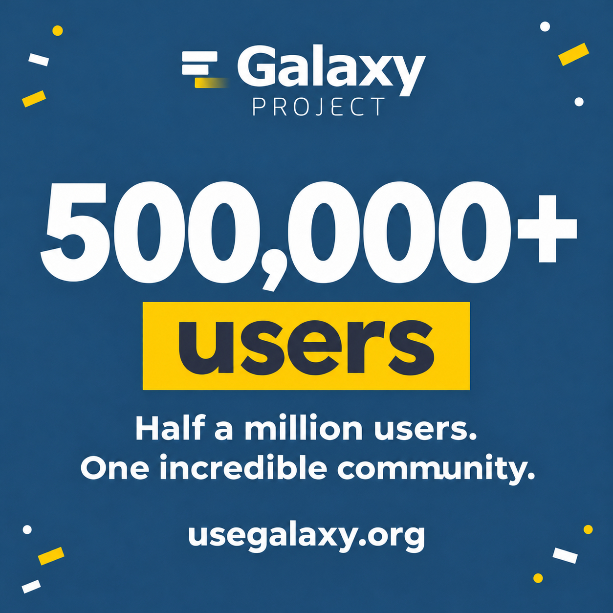

---
media:
  - mastodon-galaxyproject
hashtags:
  mastodon-galaxyproject:
  - usegalaxy
  - OpenScience
---

🎉 Half a million users. One stellar community.

usegalaxy.org surpassed 500,000 users in October 2026!

Thank you to everyone who makes Galaxy a place to explore, discover, and share. Here’s to the next chapter of open science! 🚀

https://usegalaxy.org
